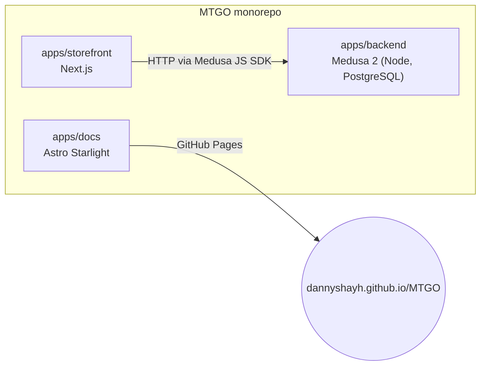

MTOGO is a Turborepo monorepo with npm workspaces. Each app lives in its own folder under `apps/`.

The architecture rules (dependency-cruiser) forbid imports between the storefront and the backend, imports between custom modules, and circular dependencies.

## Glossary, decisions and modules

These pages are copied from the repository at every build, so the file in the repository stays the only source. Edit the source, never the page on the site.

- [Glossary](/MTGO/architecture/glossary/): the language of the product and of the way the team works, from `GLOSSARY.md`.
- [Dependency graph](/MTGO/architecture/dependency-graph/): the backend's imports, generated from the architecture rules.
- Decisions: the architecture decision records from `docs/adr/`, starting with [ADR-0001](/MTGO/architecture/decisions/0001-vitest-for-the-docs-app/).
- Modules: the README next to each app folder, starting with the [backend](/MTGO/architecture/modules/backend/).
