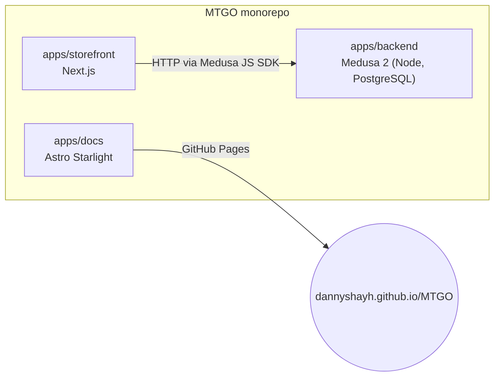

MTOGO is a Turborepo monorepo with npm workspaces. Each app lives in its own folder under `apps/`.

The architecture rules (dependency-cruiser) forbid imports between the storefront and the backend, imports between custom modules, and circular dependencies.

## Coming next

- The glossary and the architecture decisions (ADRs) on the site, and a generated dependency graph of the backend: [issue #13](https://github.com/DannyShayH/MTGO/issues/13).
- Until then, the sources are [`GLOSSARY.md`](https://github.com/DannyShayH/MTGO/blob/main/GLOSSARY.md) and [`docs/adr/`](https://github.com/DannyShayH/MTGO/tree/main/docs/adr) in the repository.
