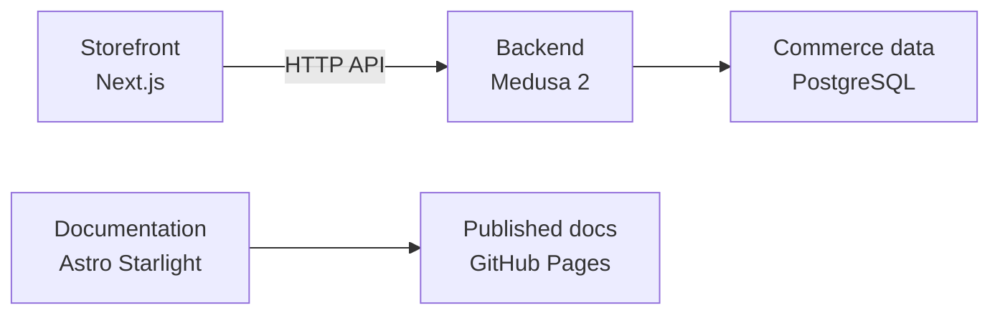
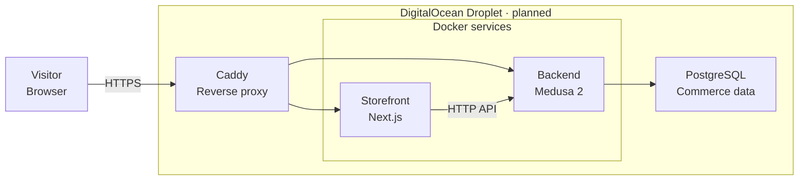

import SectionLinks from "../../../components/section-links.astro"

MTOGO brings together a Next.js storefront, a Medusa backend and this documentation site. They share a Turborepo repository with npm workspaces, while each application lives in its own folder under `apps/`.

## How the applications connect

The storefront calls the backend over HTTP using the Medusa JS SDK. The backend owns the commerce data in PostgreSQL. The docs site builds separately and publishes to GitHub Pages.

<figure class="docs-diagram not-content">
  <figcaption id="applications-title">Application structure</figcaption>
  

  

  
Storefront: apps/storefront. Backend: apps/backend. Documentation: apps/docs. On smaller screens, scroll the diagram horizontally.

</figure>

The architecture checks enforce these boundaries: no imports between the storefront and backend, no direct imports between custom backend modules, and no circular dependencies. Within the backend, API routes call workflows, and workflows coordinate modules.

## Planned application hosting

DigitalOcean is the intended application host. The deployment plan uses one Droplet for the application services and PostgreSQL, with Caddy in front of the Docker services. **This is a deployment proposal: the repository does not yet configure or deploy this setup.** The documentation already has its own GitHub Pages deployment.

<figure class="docs-diagram not-content">
  <figcaption id="hosting-title">Proposed DigitalOcean deployment</figcaption>
  

  

  
Proposed request routing, not a deployment inventory. PostgreSQL shares the application Droplet. Persistent storage, backups and deployment automation still need to be decided.

</figure>

[Caddy's reverse proxy](https://caddyserver.com/docs/caddyfile/directives/reverse_proxy) would route incoming requests to the application services. Docker would run the services on the Droplet. PostgreSQL runs on the same Droplet and is accessed by the backend.

## Find the right reference

The **glossary** defines our shared language: what a work item or WIP means, and which terms we use consistently. **Metric definitions** explain the dashboard's calculations, data sources and counting rules. Keep both references: they answer different questions.

<SectionLinks
  label="Architecture resources"
  links={[
    {
      title: "Technology stack",
      href: "/MTGO/architecture/technology-stack/",
      description:
        "Technologies in use, their responsibilities and decisions still to make.",
    },
    {
      title: "Shared glossary",
      href: "/MTGO/architecture/glossary/",
      description:
        "Product and workflow vocabulary, preferred terms and synonyms to avoid.",
    },
    {
      title: "Metric definitions",
      href: "/MTGO/flow-metrics/definitions/",
      description:
        "Calculations, data sources and counting rules behind the dashboard.",
    },
    {
      title: "Dependency graph",
      href: "/MTGO/architecture/dependency-graph/",
      description:
        "Explore the backend's actual imports and module boundaries.",
    },
    {
      title: "Architecture decisions",
      href: "/MTGO/architecture/decisions/0001-vitest-for-the-docs-app/",
      description:
        "The reasons and tradeoffs behind recorded technical decisions.",
    },
    {
      title: "Backend module documentation",
      href: "/MTGO/architecture/modules/backend/",
      description: "Read the backend's responsibilities, setup and usage.",
    },
  ]}
/>

The glossary, decisions and module documentation are published from their repository sources. To update them, edit `GLOSSARY.md`, `docs/adr/` or the relevant module's `README.md`.

