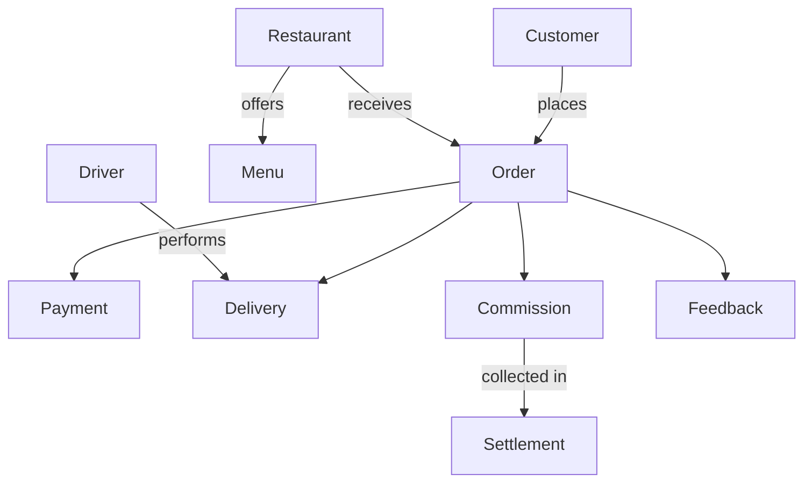
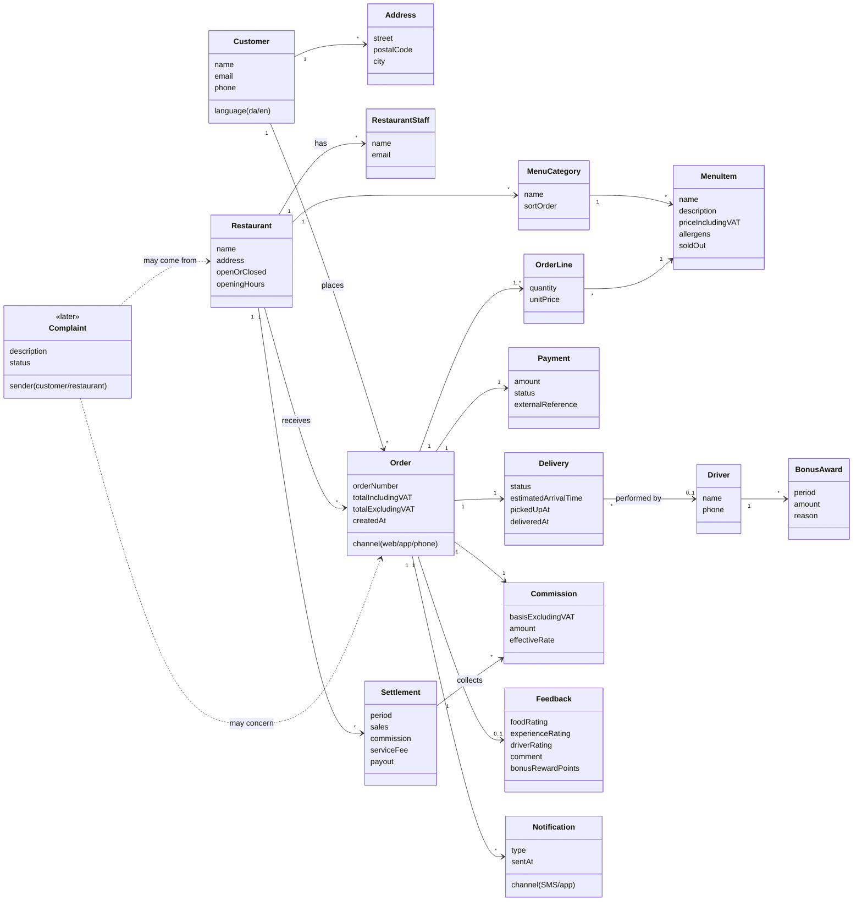

import ModelDiagram from "../../../components/model-diagram.astro"
import SectionLinks from "../../../components/section-links.astro"
import "../../../styles/review-documents.css"

<aside class="review-intro not-content" aria-label="Document status">
  <strong>Draft for team review</strong>
  

    Proposed business model for{" "}
    <a href="https://github.com/DannyShayH/MTGO/issues/10">issue #10</a>. The
    team has not approved it. Ten open questions need discussion before the
    model guides implementation.
  

</aside>

The model describes the business rather than the database. The Medusa column identifies proposed reuse of the framework and the custom modules we expect to build. It does not describe features already implemented.

<nav class="review-jump not-content" aria-label="Domain model sections">
  <a href="#business-overview">Business overview</a>
  <a href="#concepts-and-proposed-implementation">Concept reference</a>
  <a href="#proposed-delivery-lifecycle">Delivery lifecycle</a>
  <a href="#open-questions-for-the-team">Open decisions</a>
</nav>

## Business overview

A customer places an order with a restaurant. The restaurant prepares the food, a driver delivers it, and MTOGO records payment, commission and customer feedback.

<ModelDiagram id="business-overview-diagram" title="How the business connects" description="A simplified view of the proposed relationships. Read the complete model below for attributes and cardinalities. Scroll horizontally on smaller screens.">

</ModelDiagram>

**Assumptions to discuss:** One restaurant, one payment and one delivery per order. The one-restaurant rule and rejection/refund paths are still open.

Complete model and attributes

All relationships from the supplied draft are preserved here. Start at Order and follow its connections. Use the controls to zoom, fit the whole model or read it in full screen.

<ModelDiagram id="complete-domain-diagram" title="Complete domain model" description="1 means exactly one; * means many; 0..1 means optional; 1..* means at least one. Dashed links describe future complaints. Scroll in either direction to explore." detailed>

</ModelDiagram>

## Concepts and proposed implementation

| Concept             | Meaning                                                      | In Medusa (proposed)         | Custom module (proposed)                                    |
| ------------------- | ------------------------------------------------------------ | ---------------------------- | ----------------------------------------------------------- |
| Customer            | The consumer ordering food                                   | Built-in Customer            | None                                                        |
| Address             | Delivery address                                             | Built-in customer address    | None                                                        |
| Restaurant          | The supplier preparing food and paying commission            | None                         | `restaurant`                                                |
| RestaurantStaff     | Restaurant users with their own login                        | None                         | `restaurant` (called RestaurantAdmin in the planning guide) |
| MenuCategory        | Menu grouping, such as Pizza or Drinks                       | Built-in product category    | Link to restaurant                                          |
| MenuItem            | A dish with a price                                          | Built-in product and variant | Link to restaurant                                          |
| Order and OrderLine | The order and its lines                                      | Built-in order and line item | Links to restaurant and delivery                            |
| Payment             | Payment through the external provider                        | Built-in payment             | Mock payment provider                                       |
| Delivery            | The delivery and its status                                  | None                         | `delivery`                                                  |
| Driver              | A driver employed by MTOGO                                   | None                         | `delivery`                                                  |
| Commission          | MTOGO's revenue from one order                               | None                         | `commission`                                                |
| Settlement          | Settlement with a restaurant for a period                    | None                         | `commission`                                                |
| Feedback            | The customer's three ratings after delivery                  | None                         | `feedback`                                                  |
| BonusAward          | A driver's bonus for a period                                | None                         | `bonus`                                                     |
| Notification        | SMS or app message about order status                        | Built-in notification        | Mock SMS provider                                           |
| Complaint           | A complaint from a customer or restaurant, planned for later | None                         | Future `complaint` module                                   |
| MTOGO employee      | An internal user operating the platform                      | Built-in admin user          | None                                                        |

These definitions are provisional. The [shared glossary](/MTGO/architecture/glossary/) currently defines workflow vocabulary; agreed product terms should be added there during the team review.

## Proposed delivery lifecycle

The supplied draft bases these statuses on a Medusa restaurant guide. The sequence is a proposal to validate, particularly whether a driver must claim a delivery before food preparation begins.

<figure
  class="workflow-figure not-content"
  aria-labelledby="workflow-figure-title"
>
  <figcaption id="workflow-figure-title">From payment to delivery</figcaption>
  <ol
    class="workflow-timeline"
    role="list"
    aria-label="Proposed delivery sequence"
  >
    <li>
      
        1
      
      

        <strong>Pending</strong>
        
Customer pays.

      

    </li>
    <li>
      
        2
      
      

        <strong>Restaurant accepted</strong>
        
The restaurant accepts the order.

      

    </li>
    <li>
      
        3
      
      

        <strong>Pickup claimed</strong>
        
A driver claims the delivery.

      

    </li>
    <li>
      
        4
      
      

        <strong>Preparing</strong>
        
The restaurant starts preparing the food.

      

    </li>
    <li>
      
        5
      
      

        <strong>Ready for pickup</strong>
        
The food is ready.

      

    </li>
    <li>
      
        6
      
      

        <strong>In transit</strong>
        
The driver picks up the food.

      

    </li>
    <li>
      
        7
      
      

        <strong>Delivered</strong>
        
The food reaches the customer.

      

    </li>
  </ol>
  

    <strong>After delivery</strong>
    
A feedback request is sent to the customer.

  

  

    Proposed happy path. Rejection, cancellation and refund paths remain open.
    Driver assignment before preparation also needs team agreement.
  

</figure>

Each status change may send a customer notification. The draft proposes using the timestamps for delivery processing-time reporting and bonuses for early and late hours. These are business measures, separate from the project's Kanban [flow metrics](/MTGO/flow-metrics/definitions/).

## Business rules recorded from the case

The supplied draft attributes the following rules to the case. The team must confirm their interpretation against the case during review.

| Rule                                                                                                  | Source in the draft    |
| ----------------------------------------------------------------------------------------------------- | ---------------------- |
| The restaurant controls its menu; MTOGO displays it                                                   | Case                   |
| Commission is calculated on order value excluding VAT                                                 | Case                   |
| Commission decreases with order value, from 6% below DKK 101 to 3% above DKK 1,000                    | Case                   |
| The restaurant also pays a service fee                                                                | Case                   |
| The customer pays no delivery fee; delivery is included in menu prices                                | Case                   |
| All payment happens with the order; drivers do not handle money                                       | Case                   |
| The customer receives SMS or app updates as the order progresses                                      | Case                   |
| After delivery, the customer receives a request to rate the food, experience and driver               | Case                   |
| Drivers are employees and may receive bonuses based on order value, early and late hours, and ratings | Case                   |
| The bonus scheme must be financially sustainable relative to MTOGO revenue                            | Case                   |
| Customers and restaurants must be able to complain in a future extension                              | Case, future extension |

## Commission example

The draft records a suggested scale of 6% on the first DKK 100, 5% up to DKK 500, 4% up to DKK 1,000 and 3% above that. Two interpretations give different results for an order worth **DKK 600 excluding VAT**:

| Interpretation                                                            | Calculation                    | Commission | Effective rate |
| ------------------------------------------------------------------------- | ------------------------------ | ---------- | -------------- |
| Tiered: each interval has its own rate                                    | 100 × 6% + 400 × 5% + 100 × 4% | DKK 30     | 5.0%           |
| Whole amount: the final interval determines the rate for the entire order | 600 × 4%                       | DKK 24     | 4.0%           |

A tiered model avoids a drop at a threshold: an order of DKK 501 would not generate less commission than an order of DKK 499. The draft also records that the case permits a smoother formula. **No commission model has been selected.**

## Open questions for the team

These decisions are open. Record agreed answers or follow-up issues in [issue #10](https://github.com/DannyShayH/MTGO/issues/10).

### Money and incentives

- [ ] **Commission:** Tiered, whole amount, or a smooth formula?
- [ ] **Service fee:** How much, and per order or per month?
- [ ] **Bonus rules:** Which criteria and amounts, and what cap relative to commission revenue?
- [ ] **Bonus hours:** What counts as early and late hours?

### Ordering and delivery

- [ ] **Restaurant per order:** One restaurant per order?
- [ ] **Driver assignment:** Does a driver claim a delivery, or does the system assign it?
- [ ] **Cancellation and refunds:** What happens if the restaurant rejects an order or the food never arrives?
- [ ] **Phone orders:** Is a customer created if they do not already exist?
- [ ] **Scheduled orders:** Can customers order for later, or only for immediate delivery?

### Customer feedback

- [ ] **Rating scale:** 1–5 stars?

## Related workflows

<SectionLinks
  label="Workflows using the domain model"
  links={[
    {
      title: "Customer ordering",
      href: "/MTGO/product/customer-ordering/",
      description:
        "Follow the customer from selecting food to payment, delivery and feedback.",
    },
    {
      title: "Restaurant menu management",
      href: "/MTGO/product/restaurant-menu-management/",
      description:
        "Follow restaurant staff maintaining categories, dishes, prices and availability.",
    },
    {
      title: "MTOGO restaurant onboarding",
      href: "/MTGO/product/restaurant-onboarding/",
      description:
        "Follow internal MTOGO staff adding a restaurant through Medusa Admin.",
    },
    {
      title: "Driver delivery workflow",
      href: "/MTGO/product/driver-delivery/",
      description:
        "Follow the driver from receiving a delivery to pickup, customer handover and completion.",
    },
  ]}
/>

## Team review and follow-up

The diagram currently assumes one restaurant, one payment and one delivery per order. The one-restaurant rule and rejection/refund paths remain unresolved. The Feedback points field also needs clarification alongside the driver bonus rules.

Use [issue #10](https://github.com/DannyShayH/MTGO/issues/10) to record team approval and track unresolved questions and FURPS requirements as backlog issues. Publishing this draft does not complete those requirements.

