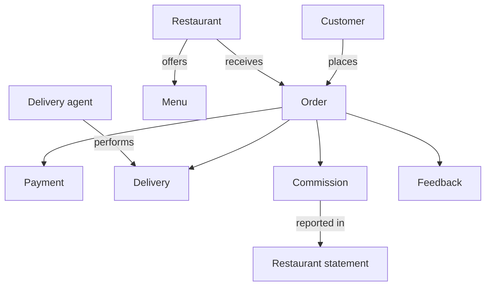
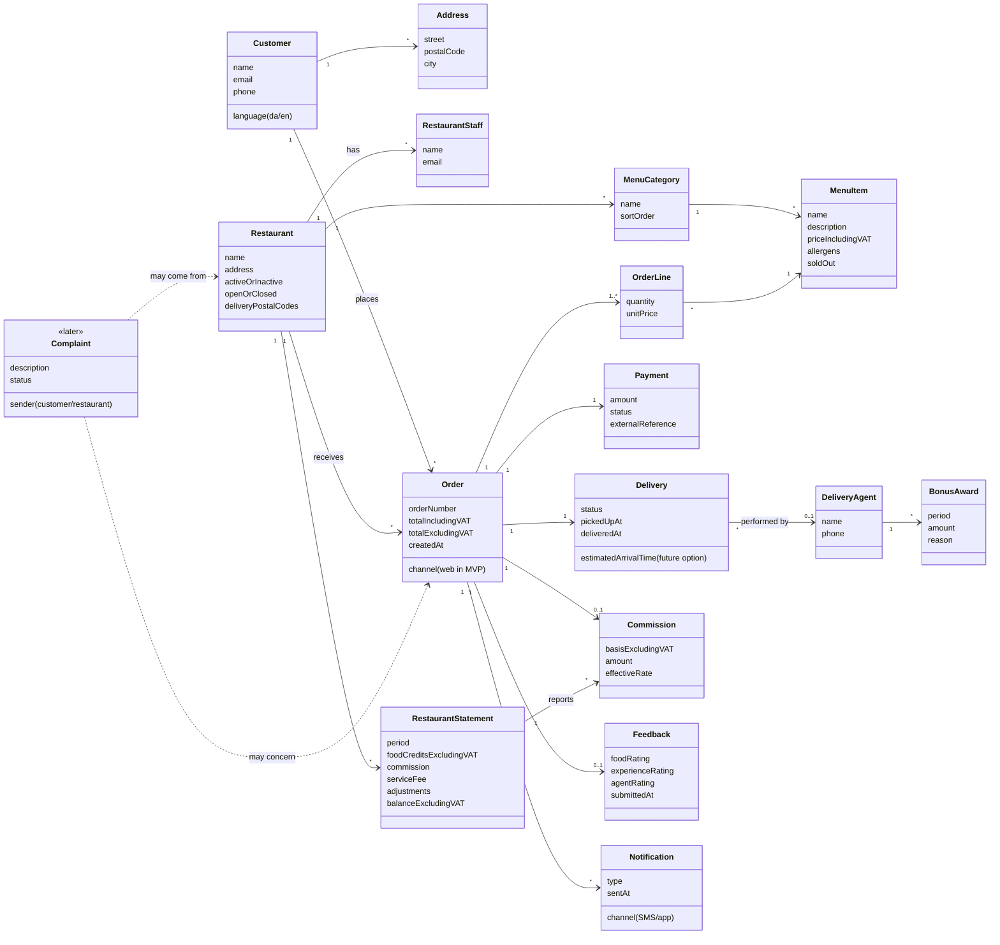
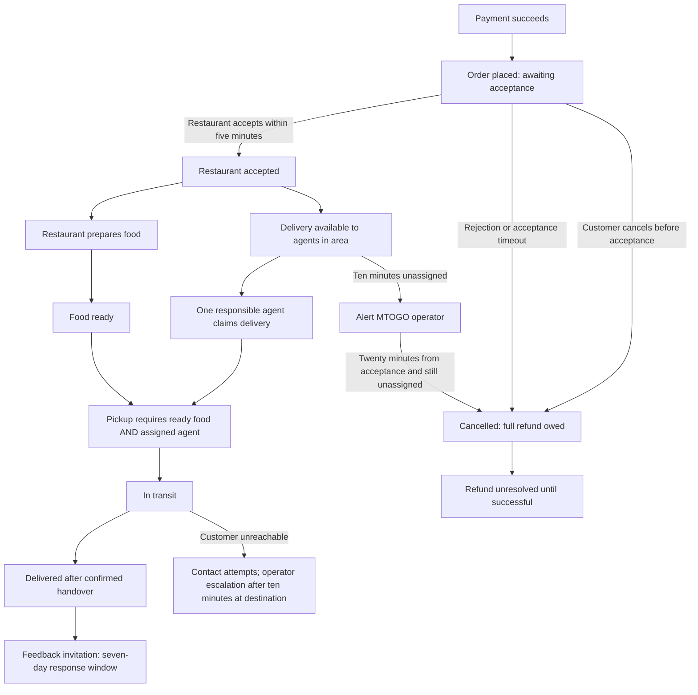

import ModelDiagram from "../../../components/model-diagram.astro"
import SectionLinks from "../../../components/section-links.astro"
import "../../../styles/review-documents.css"

<aside class="review-intro not-content" aria-label="Document status">
  <strong>Business model agreed</strong>
  

    The team agreed the MTOGO business model, language, rules and boundaries on
    11 November 2026 in issue #10, including the evolving Feature backlog and
    provisional demo milestones. Explicitly parked optional questions remain
    below. Feature implementation choices are reserved for later Feature grills.
  

</aside>

The model describes the business rather than the database. The Medusa column identifies proposed reuse of the framework and the custom modules we expect to build. It does not describe features already implemented.

The [recipe compatibility review](/MTGO/architecture/restaurant-recipe-review/) compares a pinned upstream example with installed Medusa 2.22.4. Concrete implementation choices remain for each Feature grill.

<nav class="review-jump not-content" aria-label="Domain model sections">
  <a href="#business-overview">Business overview</a>
  <a href="#concepts-and-proposed-implementation">Concept reference</a>
  <a href="#delivery-lifecycle">Delivery lifecycle</a>
  <a href="#decision-record">Decision record</a>
</nav>

## Business overview

A Customer places an Order with one Restaurant location. The Restaurant prepares the food, a Delivery agent employed by MTOGO delivers it, and MTOGO records payment, commission and customer feedback.

## Agreed foundations

- **Scope:** Website journeys for Customers, Restaurant staff, Delivery agents and MTOGO operators, in Danish and English, with mocked payment and SMS services demonstrating success and failure. Native apps, telephone ordering and scheduled orders are outside the MVP. See [ADR-0004](/MTGO/architecture/decisions/0004-website-mvp-with-mocked-external-services/).
- **Restaurant identity:** One preparation and pickup location, including a catering business operating that way; separate branches are separate Restaurants. Restaurant staff, Delivery agents and MTOGO operators are distinct business roles. See the [glossary](/MTGO/architecture/glossary/).
- **Order boundary:** One Customer, exactly one Restaurant, one destination and one intended delivery. Ordered names, quantities, prices and the destination remain historical facts after menu or saved-address changes. See [ADR-0005](/MTGO/architecture/decisions/0005-single-restaurant-orders-and-historical-facts/).
- **Fees:** Marginal commission tiers on Order value excluding VAT, plus DKK 100 excluding VAT per active Restaurant per month under a common MVP policy. The service fee is prorated by active Copenhagen calendar days, with historical amounts preserved. See [ADR-0006](/MTGO/architecture/decisions/0006-marginal-commission-and-monthly-service-fee/).
- **Access and participation:** Customers sign in before submission and access their own Orders. Restaurant staff operate their own Restaurant; operators create Restaurants and agent access. Agent contact-data access starts after assignment. Restaurant activation is separate from manual open/closed availability, and delivery areas use postal codes. See [ADR-0008](/MTGO/architecture/decisions/0008-role-boundaries-and-restaurant-activation/).
- **Order acceptance and delivery:** Charge at submission and place the Order on payment success, before acceptance or assignment. Rejection or no acceptance within five minutes cancels it with a full refund owed. After acceptance, preparation and assignment proceed independently; agents claim one active delivery at a time in their area. See [ADR-0009](/MTGO/architecture/decisions/0009-paid-orders-and-independent-preparation-and-assignment/).
- **Bonuses and Feedback:** A monthly bonus pool capped at 20% of commission revenue after refunds and reversals, excluding service fees. Voluntary Feedback has separate 1–5 food, experience and agent ratings, one uneditable submission by the ordering Customer within seven days of delivery. See [ADR-0010](/MTGO/architecture/decisions/0010-commission-funded-bonuses-and-separate-feedback-ratings/).
- **Planning:** Five developers pull Features in priority order. Weeks 47–49 have [provisional demo goals](/MTGO/product/mvp-and-roadmap/), rather than fixed time budgets or a fixed delivery plan.

The business foundations and rules below are agreed. Medusa module mappings remain implementation proposals to validate during the relevant Feature grill; agreement on the business model does not claim implemented functionality.

<ModelDiagram id="business-overview-diagram" title="How the business connects" description="A simplified view of the proposed relationships. Read the complete model below for attributes and cardinalities. Scroll horizontally on smaller screens.">

</ModelDiagram>

**Agreed:** One Restaurant, one Customer, one destination and one intended delivery per Order, placed after payment success and before Restaurant acceptance. **Meaning of the Payment relationship:** One successful full charge funds the Order. This must not hide pending/failed attempts before success, retries or later full-refund obligations; the Feature grill chooses how these records are represented. Release and reassignment are outside the MVP.

Complete model and attributes

The diagram incorporates agreed terminology, Restaurant participation and the three Feedback subjects. Order prices and destination are historical facts; payment attempts, full refunds and financial adjustments retain their history. The diagram shows business relationships rather than persistence choices, which remain for Feature grills. Start at Order and follow its connections.

<ModelDiagram id="complete-domain-diagram" title="Complete domain model" description="1 means exactly one; * means many; 0..1 means optional; 1..* means at least one. Dashed links describe future complaints. Scroll in either direction to explore." detailed>

</ModelDiagram>

## Concepts and proposed implementation

| Concept              | Meaning                                                      | In Medusa (proposed)         | Custom module (proposed)                                    |
| -------------------- | ------------------------------------------------------------ | ---------------------------- | ----------------------------------------------------------- |
| Customer             | The consumer ordering food                                   | Built-in Customer            | None                                                        |
| Address              | Delivery address                                             | Built-in customer address    | None                                                        |
| Restaurant           | The supplier preparing food and paying commission            | None                         | `restaurant`                                                |
| RestaurantStaff      | Restaurant users with their own login                        | None                         | `restaurant` (called RestaurantAdmin in the planning guide) |
| MenuCategory         | Menu grouping, such as Pizza or Drinks                       | Built-in product category    | Link to restaurant                                          |
| MenuItem             | A dish with a price                                          | Built-in product and variant | Link to restaurant                                          |
| Order and OrderLine  | The order and its lines                                      | Built-in order and line item | Links to restaurant and delivery                            |
| Payment              | Payment through the external provider                        | Built-in payment             | Mock payment provider                                       |
| Delivery             | The delivery and its status                                  | None                         | `delivery`                                                  |
| Delivery agent       | An MTOGO employee collecting and delivering food             | None                         | `delivery`                                                  |
| Commission           | MTOGO's revenue from one order                               | None                         | `commission`                                                |
| Restaurant statement | Monthly commercial account excluding VAT                     | None                         | `commission`                                                |
| Feedback             | The customer's three ratings after delivery                  | None                         | `feedback`                                                  |
| BonusAward           | A delivery agent's bonus for a period                        | None                         | `bonus`                                                     |
| Notification         | SMS or app message about order status                        | Built-in notification        | Mock SMS provider                                           |
| Complaint            | A complaint from a customer or restaurant, planned for later | None                         | Future `complaint` module                                   |
| MTOGO operator       | An internal employee operating the platform                  | Built-in admin user          | None                                                        |

The [shared glossary](/MTGO/architecture/glossary/) holds agreed product and workflow language. The Medusa mappings are provisional; code-level names from the recipe do not define the business vocabulary.

## Delivery lifecycle

The agreed core separates Order acceptance, Restaurant preparation, agent assignment and payment resolution. It replaces the original sequence that put agent assignment before Order creation and preparation. Cancellation, unclaimed work and handover-failure rules are agreed below; the diagram describes business behavior, not API values or an implementation.

<ModelDiagram id="delivery-lifecycle-diagram" title="Paid Order, acceptance and parallel preparation and assignment" description="Successful payment places an Order. Rejection or five minutes without acceptance requires cancellation and a full refund. On acceptance, preparation and assignment proceed independently; both must be ready before pickup.">

</ModelDiagram>

- Successful payment creates the Order awaiting acceptance. An uncertain payment remains pending while checked; retries must not create another purchase or charge.
- The Restaurant has five minutes to accept. Rejection or timeout cancels the Order with a full refund owed. A failed refund remains visibly unresolved until successful, and Order/payment history remains.
- Agents claim available deliveries in their operating area, holding at most one active delivery each. Competing claims produce one responsible agent; operators can handle initial assignment and exceptions. Agent release and reassignment are outside the MVP, before and after pickup.
- Restaurant preparation may begin on acceptance while an agent is still being found. Pickup requires both ready food and an assigned agent.
- Agent account access, Restaurant participation and current opening availability are separate concerns. Revoking access preserves history; closing or deactivating a Restaurant does not abandon its existing Orders.
- Customers may browse without signing in but must sign in before submission. Customers see their own Orders, Restaurant staff see their Restaurant's menu and Orders, and assigned agents receive the Customer contact details needed for delivery.

The [agreed Feature backlog](/MTGO/product/feature-backlog-proposal/) records MoSCoW scope, ordering, dependencies and provisional milestone groups. Implementation choices belong to Feature grills. See [ADR-0008](/MTGO/architecture/decisions/0008-role-boundaries-and-restaurant-activation/) and [ADR-0009](/MTGO/architecture/decisions/0009-paid-orders-and-independent-preparation-and-assignment/).

## Cancellation, handover and recovery

- Alert an operator after ten minutes without assignment; cancel after twenty minutes if still unassigned. Both periods start at Restaurant acceptance. Refund the Customer in full; MTOGO carries the loss of food already prepared. Credit the Restaurant the full food value excluding VAT with no commission, as a loss funded by MTOGO.
- Customers may cancel themselves before acceptance with a full refund. After acceptance an operator must handle cancellation: before preparation starts a full refund is available; after preparation starts a change of mind has no automatic refund, but an operator can grant a reasoned exception. Restaurant inability to fulfil requires a full refund.
- Confirm delivery only after handover to the Customer or a designated recipient. An unreachable Customer triggers contact attempts and operator escalation after ten minutes at the destination, never a false delivered status. Customer-caused failed handover has no automatic refund; MTOGO-caused failure requires a full refund.
- Operators may correct mistakes with a reason, retaining original events and the identity of the person making the correction. Agent release and reassignment are outside the MVP; corrections do not add that excluded workflow.
- Paid Orders, responsibilities and financial history survive restarts. Handle expired business deadlines after recovery. Repeated submissions and competing claims preserve the agreed guarantees. Unauthorized users cannot access another party's information, and failed payments, refunds and notifications remain visible until resolved.

See [ADR-0011](/MTGO/architecture/decisions/0011-order-failures-cancellation-and-mvp-handover/) and [ADR-0014](/MTGO/architecture/decisions/0014-durable-business-state-and-auditable-corrections/).

## Restaurant menu and service fee

Restaurant staff publish their own menu without MTOGO dish approval. Category and dish names require Danish and English; optional descriptions need both languages when supplied. Restaurants provide allergen information and unknown information stays visibly unknown. Prices are positive DKK amounts including VAT and delivery. Valid saved changes become visible immediately; sold-out dishes stay visible but cannot be ordered. Recheck prices and availability before payment: changes require Customer review, never silent substitution or an increased charge. Removed menu content preserves historical Orders. Dish options, meal customization, promotions and tips are outside the MVP. See [ADR-0012](/MTGO/architecture/decisions/0012-restaurant-owned-bilingual-menus/).

[Discovery #102](https://github.com/DannyShayH/MTGO/issues/102) refined and confirmed the menu journey on 13 November 2026: Restaurant-owned flat categories, exactly one category per dish, manual sold-out status, stale-save protection, explicit allergen declarations and separate halal, chili and garlic labels, and optional secure photos. An active Restaurant cannot lose its last published dish; closed active menus remain readable, while inactive menus are hidden. The 14 allergen groups are seeded database reference data with stable EU numbers 1–14 and bilingual names; the three extra labels have separate codes without EU numbers. The [menu workflow](/MTGO/product/restaurant-menu-management/) records the agreed details, required design skills and acceptance examples; specification and implementation follow separately.

The DKK 100 excluding VAT service fee uses Copenhagen calendar months, counting each day on which the Restaurant was active once. Calculate DKK 100 times active days divided by days in the month, rounding the final amount once to two decimals. Temporary closure remains billable; inactive days do not. Fifteen active days in a thirty-day month cost DKK 50 excluding VAT. See [ADR-0006](/MTGO/architecture/decisions/0006-marginal-commission-and-monthly-service-fee/).

## Financial recognition and reporting

The exercise assumes 25% VAT on menu prices. Commission uses the resulting food value excluding VAT, is earned on successful delivery and is rounded once to two decimals. Full refunds reverse the original commission amount. Commercial-term changes affect future business and preserve historical amounts. Cancellations and refunds concern the whole Order in the MVP; partial refunds are outside scope.

| Outcome                                                                    | Food credit excluding VAT             | Commission        |
| -------------------------------------------------------------------------- | ------------------------------------- | ----------------- |
| Successfully delivered                                                     | Full food value                       | Normal commission |
| Cancelled before preparation                                               | None                                  | None              |
| Restaurant cannot fulfil                                                   | None                                  | None              |
| MTOGO fails after preparation                                              | Full food value funded by MTOGO       | None              |
| Customer cancellation or Customer-caused failed handover after preparation | Full food value from retained payment | None              |

Customer refunds return the full amount actually paid. A goodwill refund records who bears the loss. Monthly Restaurant statements show food credits, commission, service fees, adjustments and the resulting balance excluding VAT. Actual bank transfers, tax invoicing and payroll integration are outside the MVP; a commercial statement is not a completed payout or tax invoice. See [ADR-0006](/MTGO/architecture/decisions/0006-marginal-commission-and-monthly-service-fee/).

## Authority and operational attention

Operators manage Restaurant staff and agent access, operating areas, activation/deactivation and commercial terms. Restaurant staff manage only their own menu, opening availability, acceptance and preparation, and see their own commercial statements. Agents claim work and report progress for assigned deliveries, and see their own work and bonuses. Operators handle refunds and reasoned corrections without impersonating Customer Feedback. Other Restaurants' and agents' financial details stay private.

Alert operators after thirty minutes from acceptance without pickup, or thirty minutes from pickup without delivery. These trigger investigation and recorded continuation or failure, not automatic cancellation or a promised delivery time. A payment result still uncertain after five minutes needs attention without another charge or a false failure. See [ADR-0008](/MTGO/architecture/decisions/0008-role-boundaries-and-restaurant-activation/) and [ADR-0011](/MTGO/architecture/decisions/0011-order-failures-cancellation-and-mvp-handover/).

## Management measures and growth baseline

- **Open Orders:** Paid Orders neither delivered nor cancelled/failed.
- **Orders in the last 24 hours:** Orders placed in that rolling period, with cancellations shown separately.
- **Average Orders per day:** Placements in the previous seven complete Copenhagen calendar days divided by seven, including zero-Order days.
- **Average processing time:** Placement to confirmed handover, for Orders delivered in the last 24 hours.
- **Attention:** Show unresolved payments/refunds and deliveries needing operator attention separately; missing history/timestamps is unavailable with visible exclusions.

Operators see the platform overview; Restaurant staff see only their Restaurant's information. See [ADR-0015](/MTGO/architecture/decisions/0015-management-measures-and-visible-exclusions/).

The school-project validation baseline is twenty simultaneous user journeys: ordinary browsing/status requests within two seconds for 95% of requests, and Order submission within five seconds with an immediately responding mock provider. Verify management and financial reporting with 50,000 synthetic Customers and 200,000 historical Orders. These are testable exercise assumptions rather than a production service guarantee; Feature grills choose relevant setup and evidence. See [ADR-0014](/MTGO/architecture/decisions/0014-durable-business-state-and-auditable-corrections/).

## Order timeline and notifications

The Customer website displays an Order timeline with the same business progress information as mocked SMS: placement, acceptance, preparation starting, readiness, pickup, delivery and cancellation, plus the Feedback invitation. The reference to the app stays within the website MVP. Record the Customer's chosen language with the Order and use it for messages.

The website remains the place to check current status. Failed SMS does not block food preparation or delivery; unsuccessful messages stay visible for operator attention and retries avoid duplicate messages. Include an Order reference and status without unnecessary personal or address details. See [ADR-0013](/MTGO/architecture/decisions/0013-order-timeline-and-independent-notification-delivery/).

## Bonus funding and Feedback

The calendar-month bonus pool is capped at 20% of positive commission remaining after refunds, reversals, MTOGO-funded food compensation and carried losses. Service fees are excluded; a zero or negative commission balance yields no pool and unused budget stays with MTOGO. This limits bonus expense without claiming overall profitability: salaries and other operating costs are unspecified. For each successfully delivered Order, base points equal its value excluding VAT. Multiply by 1.25 for pickup in Copenhagen early hours (06:00–09:00) or late hours (21:00–06:00), and by 1.10 for an agent rating of 4 or 5. Time-window ends are exclusive. Other ratings and missing Feedback retain the baseline. Share the available pool proportionally to each agent's points; DKK 200 at 22:00 with five stars yields 275 points.

Finalize the previous month on the 8th, allowing the Feedback window to finish. Later refunds reduce future funding and negative balances carry forward; previously finalized awards are not deducted from wages. Approved refund obligations count even if provider execution remains unresolved. Orders fully refunded before finalization earn no points. Round awards down to increments of DKK 0.01 and retain the remainder. The available pool is capped at 20% of positive commission remaining after refunds, reversals, MTOGO-funded food compensation and carried losses; DKK 1,000 commission minus DKK 300 compensation permits at most DKK 140. Agents see their own completed work, points and clearly distinguished provisional/final bonus amounts.

After successful delivery, only the ordering Customer may submit voluntary Feedback: three separate 1–5 ratings for food, overall experience and the individual agent. One submission per delivered Order is accepted within seven days and cannot be edited in the MVP. Missing feedback remains unrated. Only the agent rating may affect that individual's rating-based bonus; poor food ratings must not reduce the agent's reward. See [ADR-0010](/MTGO/architecture/decisions/0010-commission-funded-bonuses-and-separate-feedback-ratings/).

## Business rules recorded from the case

The table records requirements from the case. The agreed interpretations and scope decisions are explained above and in the ADRs.

| Rule                                                                                                          | Source                 |
| ------------------------------------------------------------------------------------------------------------- | ---------------------- |
| The restaurant controls its menu; MTOGO displays it                                                           | Case                   |
| Commission is calculated on order value excluding VAT                                                         | Case                   |
| Commission decreases with order value, from 6% below DKK 101 to 3% above DKK 1,000                            | Case                   |
| The restaurant also pays a service fee                                                                        | Case                   |
| The customer pays no delivery fee; delivery is included in menu prices                                        | Case                   |
| All payment happens with the order; delivery agents do not handle money                                       | Case                   |
| The customer receives SMS or app updates as the order progresses                                              | Case                   |
| After delivery, the customer receives a request to rate the food, experience and delivery agent               | Case                   |
| Delivery agents are employees and may receive bonuses based on order value, early and late hours, and ratings | Case                   |
| The bonus scheme must be financially sustainable relative to MTOGO revenue                                    | Case                   |
| Customers and restaurants must be able to complain in a future extension                                      | Case, future extension |

## Commission example

The case provides an illustrative scale of 6% on the first DKK 100, 5% up to DKK 500, 4% up to DKK 1,000 and 3% above that. Two interpretations give different results for an order worth **DKK 600 excluding VAT**:

| Interpretation                                                            | Calculation                    | Commission | Effective rate |
| ------------------------------------------------------------------------- | ------------------------------ | ---------- | -------------- |
| Tiered: each interval has its own rate                                    | 100 × 6% + 400 × 5% + 100 × 4% | DKK 30     | 5.0%           |
| Whole amount: the final interval determines the rate for the entire order | 600 × 4%                       | DKK 24     | 4.0%           |

**Agreed:** Use marginal tiers, avoiding a commission drop at a threshold. DKK 600 excluding VAT produces DKK 30 commission; DKK 1,100 produces DKK 49, an effective rate of approximately 4.45%. The 3% band is a marginal rate on the amount above DKK 1,000, not a 3% effective rate on the whole Order. See [ADR-0006](/MTGO/architecture/decisions/0006-marginal-commission-and-monthly-service-fee/).

## Decision record

Checked entries record agreements from the business grill. Unchecked entries are unresolved; they have not been silently deferred or assigned a default. Record further agreements or explicitly parked questions with their reasons here and in [issue #10](https://github.com/DannyShayH/MTGO/issues/10).

### Money and incentives

- [x] **Commission model:** Marginal tiers: 6% on the first DKK 100, 5% on the next DKK 400, 4% on the next DKK 500 and 3% on the remainder, excluding VAT.
- [x] **Service-fee basis:** A separate fixed monthly fee per active Restaurant.
- [x] **Service-fee amount:** DKK 100 excluding VAT per active Restaurant per month, common to all Restaurants in the MVP, as a project exercise assumption.
- [x] **Service-fee billing:** Copenhagen calendar months, prorated by days active at any point, counted once per day; temporary closure stays billable and the final fee is rounded once to two decimals.
- [x] **Restaurant statements:** Monthly food credits, commission, service fees, adjustments and balances excluding VAT; bank transfers, tax invoicing and payroll integration are outside the MVP.
- [x] **Financial lifecycle:** Exercise menu VAT 25%; commission earned on delivery and rounded once to two decimals, full reversals use original amounts, whole-Order refunds only, historical commercial amounts preserved and future changes prospective. Food credits follow the agreed responsibility table.
- [x] **Bonus funding cap:** At most 20% of calendar-month commission revenue after refunds and reversals, excluding service fees; no pool on a zero or negative balance, and unused budget remains with MTOGO.
- [x] **Bonus allocation:** Delivered net Order value supplies points, multiplied by 1.25 for early/late pickup and 1.10 for agent ratings of 4 or 5; share the pool proportionally and finalize on the 8th. Later refunds reduce future funding; negative balances carry forward without wage deductions.
- [x] **Bonus financial details:** Refund obligations count before provider completion; pre-finalization full refunds remove points; food compensation and carried losses reduce funding. Awards round down to DKK 0.01 increments; rounding remainder stays with MTOGO.
- [x] **Bonus hours:** Copenhagen early hours 06:00 to before 09:00; late hours 21:00 to before 06:00.

### Ordering and delivery

- [x] **Restaurant per Order:** Exactly one Restaurant location, one Customer, one destination and one intended delivery; retain historical Order facts.
- [x] **Delivery agent assignment:** Agents claim available deliveries in their area, with one active delivery each, one responsible agent per delivery and operator intervention available.
- [x] **Rejection and acceptance timeout:** Rejection or no acceptance within five minutes cancels the Order with a full refund owed; failed refunds remain visibly unresolved.
- [x] **Unclaimed work:** Operator alert after ten minutes, cancellation after twenty minutes if still unassigned, from acceptance; full Customer refund and MTOGO bears prepared-food loss.
- [x] **Customer cancellation:** Self-service before acceptance; operator handling after acceptance. Full refund before preparation starts; after that a change of mind has no automatic refund, with reasoned operator exceptions possible.
- [x] **Handover:** Customer or designated recipient; contact attempts and operator escalation after ten minutes for an unreachable Customer. Customer-caused failure has no automatic refund; MTOGO-caused failure requires a full refund.
- [x] **Reassignment:** Agent release and reassignment are outside the MVP, before and after pickup.
- [x] **Stalled assigned work:** Attention after thirty minutes from acceptance without pickup or thirty minutes from pickup without delivery; operator records continuation or failure. Uncertain payments need attention after five minutes without duplicate charging.
- [x] **Phone orders:** Outside the MVP; account creation for this future channel is not specified.
- [x] **Scheduled orders:** Outside the MVP; the first journey is for immediate delivery.
- [x] **Customer accounts and access:** Free browsing, sign-in before submission and own-Order access; Restaurant staff operate their own Restaurant, operators create Restaurants and agent access, and agents receive contact details only after assignment.
- [x] **Access administration:** Operators manage staff/agent access, areas, activation and terms; staff manage their own menus, opening and preparation; agents report assigned deliveries. Own statements and bonus information stay private from other Restaurants/agents.
- [x] **Corrections:** Operator changes require a reason, retain original events and identify the person making the correction.
- [x] **Activation and ordering eligibility:** Explicit operator activation, address, contact details, staff, commercial terms, published menu and postal-code delivery area; active/open status and item availability checked for new Orders.
- [x] **Menu rules:** Bilingual names, bilingual descriptions when supplied, Restaurant-provided allergens with unknown information visible, positive DKK prices including VAT and delivery, immediate publishing, visible sold-out dishes and Customer review of checkout changes.
- [x] **Payment and acceptance:** Charge at submission; payment success places an Order awaiting acceptance, independently of assignment. Uncertain results stay pending while checked and retries do not duplicate charges or purchases.
- [x] **Preparation and assignment:** Proceed independently after acceptance; pickup requires ready food and an assigned agent.
- [x] **Timeline and notifications:** The website timeline and mocked SMS carry placement, acceptance, preparation, readiness, pickup, delivery, cancellation and Feedback-invitation information, in the language recorded with the Order. Notification failure does not block fulfilment and remains visible to operators; retries avoid duplicates.

### Customer feedback

- [x] **Rating scale:** Three separate 1–5 ratings for food, experience and agent.
- [x] **Feedback policy:** One voluntary submission by the ordering Customer within seven days of delivery, uneditable in the MVP; missing feedback is unrated and only the agent rating may influence the individual rating-based bonus.

### Management and product boundaries

- [x] **Dashboard measures:** Open Orders, rolling 24-hour placements with cancellations separate, daily average across seven complete Copenhagen days, processing time for deliveries in the last 24 hours, and visible attention/exclusion information with role-appropriate access.
- [x] **Reliability and documentation:** Durable paid Orders, responsibilities and financial history; recovered deadlines, safe repeated submissions and claims, enforced access boundaries, auditable corrections and visible unresolved failures. Each Feature needs user stories refined with an agent before implementation, preserving business rules.
- [x] **Growth and performance:** Twenty simultaneous journeys; 95% of browsing/status requests within two seconds, mock Order submission within five; report verification with 50,000 Customers and 200,000 historical Orders, as exercise assumptions.
- [x] **Feature planning:** Fifteen Feature parents: twelve Must have, management analytics Should have, and opening schedules/arrival estimates Could have. Ordered capabilities, native blockers and weeks 47–49 demo groups are agreed as an evolving backlog.
- [x] **Feature completion:** Accepted business outcome and all required work items delivered; the parent stays open until then. Discovery needing a branch is a work item when pulled. Reopening required work reopens completion, removed scope is explained, and missing dates remain unavailable.
- [x] **Feature measurement details:** Copenhagen calendar days; earliest sub-issue Start date includes discovery work items, original start survives scope removal, and wholly withdrawn Features have no completed lead time and appear separately. The collector still needs explicit recognition of empty Features and a Feature lead-time measure.
- [x] **Team approval:** Complete business model and backlog agreed on 11 November 2026, with optional questions and profitability limits explicitly recorded.

## Parked questions and refinement boundary

- **Actual profitability:** Salary and operating-cost figures are not provided by the case. The bonus budget is bounded after refunds and MTOGO food losses, but overall profitability cannot be proven without those inputs.
- \*\*Optional opening schedules ([#55](https://github.com/DannyShayH/MTGO/issues/55)): Manual overrides, overnight hours and exceptional closures are parked because this Could have capability is outside the required MVP. Settle them if the team pulls that Feature.
- \*\*Optional arrival estimates ([#56](https://github.com/DannyShayH/MTGO/issues/56)): Estimation inputs, update rules and delivery promises are parked because this Could have capability is outside the required MVP. The agreed timeline reports actual events without promising an arrival time.
- **Feature refinement:** Discovery #102 records the agreed menu interactions and concurrent-edit behavior. ADR-0006 now specifies financial ties away from zero at the final rounding point. Concrete Medusa mappings and test setup belong to the later specification, preserving the agreed rules. A changed business rule needs explicit agreement and updated documentation.

## Related workflows

<SectionLinks
  label="Workflows using the domain model"
  links={[
    {
      title: "Customer ordering",
      href: "/MTGO/product/customer-ordering/",
      description:
        "Follow the customer from selecting food to payment, delivery and feedback.",
    },
    {
      title: "Restaurant menu management",
      href: "/MTGO/product/restaurant-menu-management/",
      description:
        "Follow restaurant staff maintaining categories, dishes, prices and availability.",
    },
    {
      title: "MTOGO restaurant onboarding",
      href: "/MTGO/product/restaurant-onboarding/",
      description:
        "Follow internal MTOGO staff adding a restaurant through Medusa Admin.",
    },
    {
      title: "Delivery agent workflow",
      href: "/MTGO/product/driver-delivery/",
      description:
        "Follow the delivery agent from receiving a delivery to pickup, customer handover and completion.",
    },
  ]}
/>

## Agreement and follow-up

The one-Restaurant Order boundary, access, payment-before-acceptance rule, independent preparation and assignment, bonus funding and Feedback policy are agreed. The team has approved the complete business model and evolving Feature backlog. Concrete implementation choices are reserved for Feature grills. Feedback does not own bonus reward points: only its agent rating may contribute to the separately determined bonus.

The [Feature backlog](/MTGO/product/feature-backlog-proposal/) and [FURPS acceptance requirements](/MTGO/quality/product-acceptance/) provide traceability for [issue #10](https://github.com/DannyShayH/MTGO/issues/10). The fifteen published Feature parents (#42–#56) carry the agreed rules and stories; the team refines one Feature before implementation and creates its vertical work items later. Human delivery through TakT completes this issue.

