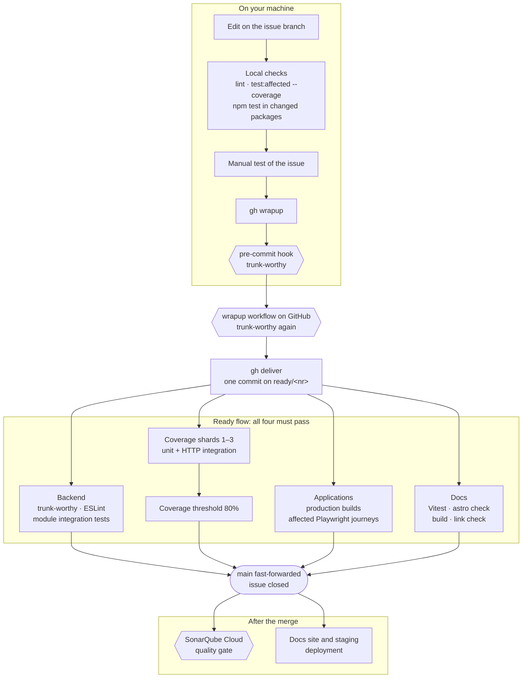

A change reaches `main` only through the ready flow. Before that, each commit
and each push runs a fast set of checks. After the merge, SonarQube and the
staging deployment check the delivered commit. This page shows all three steps
in one place. The checks are defined in `.insitu.yml`, `.githooks/pre-commit`
and the workflows in `.github/workflows/`. If this page and those files
disagree, the files are right; fix the page.

## The whole flow

Every box blocks the next step: a failed check stops the change where it is,
and you fix it on the issue branch (see [when a check fails](#when-a-check-fails)).
The checks after the merge no longer block `main`. Hexagons are the automatic
checks people meet most often.

## What runs where

| Stage                       | Trigger                                                                                                   | Checks                                                                                                                                                                                | Blocks `main`?    |
| --------------------------- | --------------------------------------------------------------------------------------------------------- | ------------------------------------------------------------------------------------------------------------------------------------------------------------------------------------- | ----------------- |
| Local checks                | You, before `gh wrapup`                                                                                   | `npm run lint`, `test:affected -- --coverage` in `apps/backend`, `npm test` in each changed `packages/*`, the manual test from the issue                                              | By agreement      |
| `trunk-worthy`              | Every commit (pre-commit hook)                                                                            | Prettier, cspell, markdownlint, ESLint, backend unit tests, coverage-tool tests, shared package and partner app tests, one React copy per Next.js app, architecture rules, ShellCheck | Yes, no commit    |
| `trunk-worthy` again        | Every push to an issue branch (`on_dev`)                                                                  | The same checks on a clean GitHub runner, so nothing depends on your machine                                                                                                          | Yes, red branch   |
| Ready: backend              | Push to `ready/*` (`gh deliver`)                                                                          | `trunk-worthy`, ESLint, backend module integration tests against PostgreSQL                                                                                                           | Yes               |
| Ready: coverage             | Push to `ready/*`                                                                                         | Backend unit and HTTP integration tests in three Jest shards, merged and held to the [80% threshold](/MTGO/quality/coverage/)                                                         | Yes               |
| Ready: applications         | Push to `ready/*`                                                                                         | Browser-test selection tests, production builds of backend, admin, storefront and partner app, affected Playwright journeys ([details](/MTGO/quality/browser-verification/))          | Yes               |
| Ready: docs                 | Push to `ready/*`                                                                                         | Live board collection, Vitest, `astro check`, site build with dead-link check, base-path link check, no board token in the output                                                     | Yes               |
| Merge to trunk              | All four ready jobs pass                                                                                  | Fast-forwards `main` to the delivered commit and closes the issue                                                                                                                     | This is the merge |
| SonarQube Cloud             | Push to `main`                                                                                            | [Static analysis](/MTGO/quality/static-analysis/) with the coverage from the ready flow; the job fails when the quality gate fails                                                    | No, it runs after |
| Docs and staging deployment | Push to `main`                                                                                            | Publishes the docs site built by the ready flow; once `STAGING_DEPLOY_ENABLED` is set, builds images and deploys to [staging](/MTGO/quality/staging-deployment/) with a smoke check   | No, it runs after |
| Dependency verification     | A change to `package.json`, the lockfile, CI files, `scripts/verify-*` or the storefront Playwright setup | [Dependency checks](/MTGO/quality/dependency-security/) on the issue branch, including application builds and browser journeys                                                        | Red branch        |

## What wrapup checks and what ready adds

`gh wrapup` commits and pushes, so it runs `trunk-worthy` twice: in the
pre-commit hook on your machine and in the wrapup workflow on GitHub. Those
checks need no database and no build, so they stay fast. Backend HTTP and
module integration tests, coverage, application builds, browser journeys and
the docs build need PostgreSQL, Chromium or minutes of build time. The ready flow runs them for every change after `gh deliver`; dependency verification also runs the builds and browser journeys on an issue branch when dependencies or CI files change. That is why AGENTS.md asks for
`test:affected` locally: it runs the specs a change touches, so a red ready run
is rare.

## Why coverage runs in three shards

The backend unit and HTTP integration tests, with coverage, are the slowest
part of the ready flow. Each HTTP spec boots its own Medusa app (about 1.5 GB)
on its own test database. A GitHub runner has 4 CPUs and 16 GB, which fits
three Jest workers next to PostgreSQL; a fourth worker starves the database
and the specs' latency checks fail.

So the ready flow splits the suite over three runners at once with Jest's
`--shard` option: shard 1 runs the first third of the spec files, shard 2 the
second and shard 3 the last. Every spec runs exactly once. Each shard uploads
only its raw coverage data and applies no threshold, because one third of the
tests cannot cover the whole backend.

The **coverage threshold** job then downloads the three reports, merges them
into one, and applies the [80% threshold](/MTGO/quality/coverage/) to the
whole backend, as if one runner had run every test. The merged report is the
coverage SonarQube reads after the merge. If any shard fails, the other shards
stop and the gate does not run, so a delivery cannot pass on partial coverage.

Locally you never run shards: `test:affected -- --coverage` runs only the specs
your change touches.

## When a check fails

- **Before delivery** (hook or wrapup workflow): fix the cause on the issue
  branch and run `gh wrapup` again. Never skip the hook with `--no-verify`.
- **In the ready flow:** `main` does not change and the issue stays in Delivery
  Initiated. Read the failed job, fix it on the issue branch, run `gh wrapup`,
  then `gh deliver` again.
- **SonarQube after the merge:** the change is already on `main`. Open a fix
  issue straight away, as described in
  [static analysis](/MTGO/quality/static-analysis/).

See the [test inventory](/MTGO/quality/test-inventory/) for how many tests of
each kind the gate runs, and the
[Definition of Done](/MTGO/way-of-working/definition-of-done/) for what else a
change needs besides green checks.
