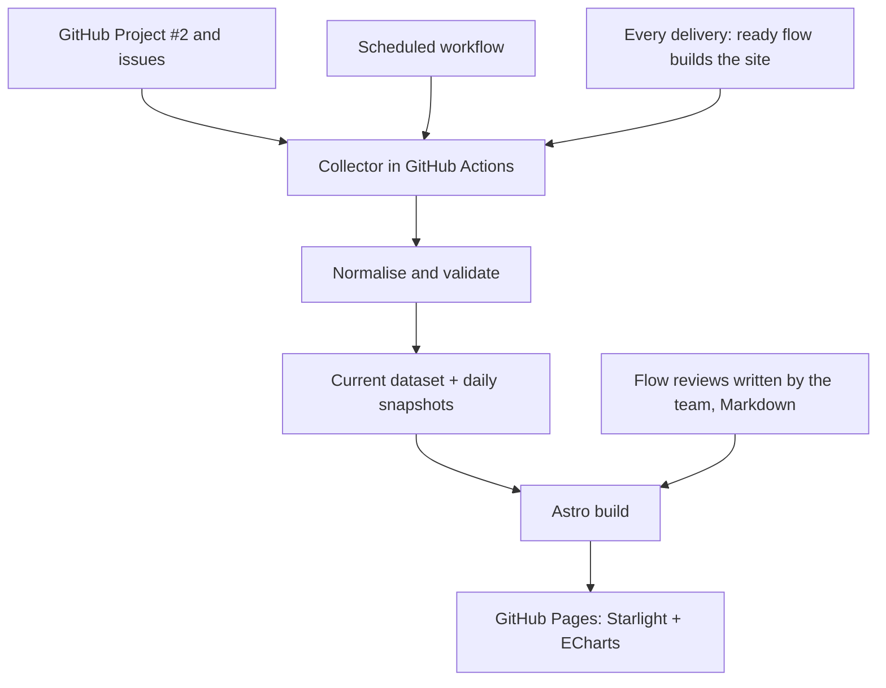

> **Superseded:** the decisions from the grill session are in epic [#12](https://github.com/DannyShayH/MTGO/issues/12), `GLOSSARY.md` (Way of working) and ADR-0001 to ADR-0003. Where this brief and those differ, they win. This page is kept until real content pages replace it.

> **Status:** draft input for `/grill-with-docs` on issue #5. Not an approved specification or ADR. Nothing here is decided until the grill session agrees on it.

**Purpose:** clarify needs, scope, architecture, data quality and delivery plan before `/to-spec` and `/to-tickets`.

**Related work:** [GitHub Project #2](https://github.com/users/DannyShayH/projects/2), issue #5 (the walking skeleton; the epic is created by `/to-spec` from this grill session), #4 (start date on `gh workon`, done), #6 (coverage threshold), #7 (SonarQube Cloud), #9 (team policies).

**Sources in this repository:** [`AGENTS.md`](https://github.com/DannyShayH/MTGO/blob/main/AGENTS.md), [`how-we-work.md`](/MTGO/way-of-working/how-we-work/), `mtogo-docs-site-og-flowmaalinger.md` (the earlier plan, in Danish, since deleted), the course slides "Kanban Basics" and "MTOGO Project Description and Requirements".

## 1. Problem and desired outcome

The Kanban process is visible on the GitHub Project board, but metrics, documentation and reflection are spread out. We want one place where the team, the PO, the teacher and the examiner can:

1. See the current state of our flow without manual input.
2. Follow WIP, cycle time and throughput over time.
3. See old or blocked issues that need attention.
4. Read the weekly flow reviews: observations, improvement experiments and follow-up.
5. Find the rest of the documentation: product, domain model, architecture, ADRs, policies, Definition of Done, releases and links to the running application.

**Success criterion:** the site makes it easier to improve the flow, not just to show nice charts. Every number can be explained and traced back to concrete GitHub issues.

## 2. What the course requires

The updated project description asks us to:

- Visualise the workflow and a prioritised backlog in GitHub Projects, apply WIP limits and pull, and monitor WIP, cycle time and throughput.
- Hold weekly flow reviews, experiment with improvements and briefly document decisions and results.
- At every weekly supervision meeting, be able to show: a working increment of the application, the board, **flow metrics and examples of workflow improvements**, CI results, and **static code analysis and code coverage results including quality gates**.
- Make deliberate, justified tool choices: "depth, justified decisions, demonstrable results and reflection are more important than the number of tools introduced."

The Kanban slides stress that the point of the metrics is continuous improvement. The weekly review answers four questions: how many issues did we finish, what was their cycle time, which active issues are old or blocked, and which change do we try next week.

**Important boundary:** a generated dashboard does not replace the weekly flow review that the team writes.

## 3. Existing team process the solution must respect

These facts are already in place and are not up for discussion in the grill session unless something is wrong with them.

| Area          | Current state                                                                                                                                                             |
| ------------- | ------------------------------------------------------------------------------------------------------------------------------------------------------------------------- |
| Board         | GitHub Project #2, owned by the user account `DannyShayH`, linked to the public repository `DannyShayH/MTGO`                                                              |
| Status column | `Backlog`, `Ready` (WIP 5), `In Progress` (WIP 3), `Delivery Initiated` (WIP 2), `Done`. The names are exact, because `gh tt` sets `In Progress` and `Delivery Initiated` |
| Other fields  | `Priority` (Must have, Should have, Could have, Won't have), `Size` (XS–XL), `Start date` (date)                                                                          |
| Labels        | Work type only (`development`, `ad hoc`, `rework`) and `blocked`                                                                                                          |
| Start date    | Set automatically to today in `Europe/Copenhagen` by `gh workon -i <nr>` (`scripts/workon.sh`) when empty. Existing and historical dates are never overwritten            |
| Closed        | Set by GitHub when the ready flow closes the issue. The project workflow _Item closed_ then moves it to Done                                                              |
| Flow          | `gh workon -i <nr>` → `gh wrapup` → `gh deliver` → ready flow (checks, merge to `main`, issue closed) → `on_main`                                                         |
| Docs as code  | Documentation changes go through the same issue, branch and quality checks as code                                                                                        |
| Roles         | PL facilitates the board, priorities and the weekly review. Tech lead owns architecture. DevOps lead owns the pipeline and secrets. Danny is the only admin on GitHub     |

The site must not become a second board or a second source of truth for issue status.

## 4. Proposed technology

- **Astro Starlight** in `apps/docs`: a finished documentation layout with navigation, search, responsive design and dark mode. Built-in, no custom design system.
- **Apache ECharts** for charts. No second chart library in the MVP.
- **Mermaid** for diagrams (architecture, domain model, flows). Needs a plugin in Starlight.
- **Minimal custom CSS** for metric cards. No Tailwind and no React islands unless a real need appears.
- **TypeScript** for the collector and the calculations, like the rest of the monorepo.

Why Starlight and not Hugo, Docusaurus or a custom site: it fits the TypeScript monorepo, Lars Kruse's `kanban-starlight` template already shows the full TakT pipeline for a Starlight site, and it gives a professional result with almost no design work. This is a recommendation for the grill session to challenge.

**Architecture principle:** as much as possible is generated statically at build time. The site is a read-only window onto GitHub data and team documents.

## 5. Information architecture

```text
MTOGO Docs (apps/docs)
├── Start here      Links to the running app (stage/prod), current version, team and roles
├── Product         Problem, MVP, roadmap, user journeys, Could haves
├── Architecture    Stack, domain model, diagrams, ADRs, modules, dependency graph
├── Way of working  Board, WIP limits, policies, Definition of Done, TakT, AI skills
├── Quality         CI results, coverage, static analysis (SonarQube, issue #7)
├── Flow metrics    Generated dashboard and explanations of each metric
├── Flow reviews    One page per week, written by the team
└── Releases        Release notes per SemVer version
```

**Documentation stays close to the source.** `GLOSSARY.md` and `docs/adr/` live at the repository root (single-context, see `docs/agents/domain.md`). Module READMEs live next to their modules. A build step copies them into the site as generated pages that are not committed. The source is always the original file. To clarify: file placement, link rewriting, and how generated files stay out of git.

## 6. Metric definitions

| Metric         | Proposed definition                                                                 | Display                                          | Data source                                           |
| -------------- | ----------------------------------------------------------------------------------- | ------------------------------------------------ | ----------------------------------------------------- |
| WIP            | Issues with status `In Progress` or `Delivery Initiated` at the time of observation | Number per column next to its limit              | Project field `Status`                                |
| Cycle time     | `closedAt − Start date`, in calendar days, for closed issues                        | Average per closing week, plus a table of issues | Project field `Start date` and the issue's `closedAt` |
| Throughput     | Issues closed in an ISO week                                                        | Bar chart and weekly numbers                     | Issue `closedAt`                                      |
| Work item age  | Observation time − `Start date` for issues that are not closed                      | Sorted list, oldest first                        | `Start date`, `Status`, observation time              |
| Blocked issues | Active issues with the label `blocked`                                              | List with links and current status               | Labels                                                |
| Ready queue    | Issues with status `Ready` (not counted as WIP)                                     | Number next to its limit                         | Project field `Status`                                |

**Rules to decide and test:**

- Which issues count? Only issues on the project. Decide how to treat epics, documentation issues, bugs, reopened issues and issues closed as "not planned".
- Missing `Start date`, reopened issues or issues moved backwards are shown as data problems. We never invent dates. Issues from before #4 (for example #2) have no start date.
- Time zone and weeks: Europe/Copenhagen and ISO weeks (Monday to Sunday). Store times in UTC and format them when displaying.
- Cycle time is calendar days including waiting time, not effective working hours. It has day resolution because `Start date` is a date.
- Keep the same definitions over time, and show when the data was last updated.
- Little's Law (average cycle time = average WIP ÷ throughput) can explain the relationship in a stable period. It is not a delivery promise.

## 7. Data flow and update strategy



**How it fits our pipeline:** Lars Kruse's pattern builds the site in `on_ready` and uploads it as an artifact, and `on_main` deploys that artifact to Pages. The collector can run in the same build, so every delivery refreshes the metrics. A scheduled workflow can rebuild and deploy on its own, so the numbers stay fresh on days without deliveries. It must build the site itself, because there is no ready-flow artifact to reuse.

**Update frequency is an open question.** The weekly review needs current numbers, not real-time numbers. A daily schedule plus every delivery is probably enough. Every 15 minutes would cost many Actions runs and Pages deploys.

**Access and security:** GitHub's built-in `GITHUB_TOKEN` cannot read a Project owned by a user account. The collector needs a separate read-only token stored as a repository secret (for example `PROJECT_READER`), created by Danny as admin. To verify: which token type and permissions are enough (a classic token with `read:project`, or a fine-grained token). Tokens live only in Actions secrets, never in client-side JavaScript or in the published JSON. The repository is public, so issue titles and assignees are already public. The site shows nothing that is not already visible on GitHub.

**Stage and production:** the docs site is our walking skeleton for CI/CD. To decide: is GitHub Pages one environment for the docs, or does the site follow the same stage/prod and tag flow as the Medusa app? We do not promise two environments without setting them up.

## 8. History and data quality

Current WIP, the blocked list and work item age only need today's project data. A Cumulative Flow Diagram needs to know the status of every issue on every day.

**Proposal:** save a daily snapshot of the board in persistent storage, for example a separate `metrics-data` branch. We do not rebuild history we never measured. First check whether the GitHub API already returns status-change history for project items.

The snapshot branch must not trigger the TakT workflows (`on_dev` reacts to branches starting with a digit and to `copilot/*`, `on_ready` to `ready/**`, `on_main` to `main`), must not create commits on `main`, and must not cause workflow loops.

Proposed data shape:

```ts
interface FlowIssue {
  id: string
  number: number
  title: string
  url: string
  status: "Backlog" | "Ready" | "In Progress" | "Delivery Initiated" | "Done"
  priority: "Must have" | "Should have" | "Could have" | "Won't have" | null
  size: "XS" | "S" | "M" | "L" | "XL" | null
  createdAt: string
  startedAt: string | null // project field "Start date"
  closedAt: string | null
  blocked: boolean
}
```

A snapshot also stores `capturedAt`, the source project, a schema version and the number of issues with missing data.

## 9. Dashboard: MVP and later

**MVP (Must have):**

- Current WIP per active column, next to the limits, plus the Ready queue.
- Throughput per week, with a chart and the underlying issues.
- Cycle time for closed issues, average per week, with a clear definition.
- Aging WIP and blocked issues, with links to GitHub.
- Time of the last successful data update, and visible errors or missing data.
- Documentation pages for the way of working, and one Markdown page per weekly flow review.

**Later (Could have):**

- Cumulative Flow Diagram from snapshots we actually collected.
- Cycle time scatterplot with median and 85th percentile, once there is enough data.
- Aging WIP chart compared with historical cycle time percentiles.
- Monte Carlo forecast from throughput history, with clear uncertainty. Not an early MVP promise.
- DORA metrics from CI/CD and deploy events, with their own source and definitions.
- Coverage and SonarQube quality gate on the Quality page (depends on #6 and #7).

**Deliberately left out of the MVP:** a backend or database only for dashboards, a custom design system, a heavy frontend framework and forecasting charts without real data.

## 10. Proposed folder structure

```text
apps/docs/
├── astro.config.mjs
├── package.json
├── scripts/
│   ├── collect-flow-metrics.ts   # reads GitHub, writes src/data (needs the token)
│   └── copy-source-docs.ts       # GLOSSARY.md, docs/adr, module READMEs, docs/planning
├── src/
│   ├── components/metrics/       # MetricCard, ThroughputChart, CycleTimeChart, AgingWip
│   ├── lib/metrics/              # types.ts, calculate.ts, validate.ts (pure functions, unit tested)
│   ├── data/                     # generated at build, not committed, never contains tokens
│   └── content/docs/             # product, architecture, way-of-working, flow-reviews, releases
└── test/fixtures/                # small sample board data for local development without a token
```

This is a suggestion to adapt to the repository and Starlight's configuration. Snapshots are kept apart from generated output.

## 11. The weekly flow review

One Markdown page per week, for example `apps/docs/src/content/docs/flow-reviews/week-47.md`, written after a meeting of about 15 minutes. The PL facilitates, everyone contributes.

```markdown
---
title: Flow review, week NN
---

Date: YYYY-MM-DD · Participants: ...

## Metrics

| Metric                                 | This week | Last week |
| -------------------------------------- | --------: | --------: |
| Throughput (issues closed)             |           |           |
| Average cycle time (calendar days)     |           |           |
| WIP at the review                      |           |           |
| WIP limit breaches (if history exists) |           |           |

## Old or blocked issues

- #nr: status, age, what blocks it, next action

## What did the data show, and what did we experience?

- ...

## One concrete improvement experiment for next week

- Change:
- Expected effect:
- How we will check the effect:

## Follow-up on last week's experiment

- What did we actually do?
- What did the metrics and observations show?
- Continue, adjust or stop?
```

A chart can show a development, but it cannot prove the cause. The team writes down its observations and reasoning.

## 12. Acceptance criteria for the first delivery

1. The Starlight site builds locally and in the ready flow, and is deployed automatically to an agreed URL.
2. The site has a start page, the way-of-working pages and navigation to the flow metrics.
3. The collector reads real issues from Project #2 with secure server-side access.
4. WIP, throughput, cycle time and work item age are calculated by documented and tested rules.
5. The dashboard explains each metric and its source, shows the last update and links to the issues.
6. Missing `Start date`, API errors and an empty dataset are handled without invented numbers.
7. At least one weekly flow review exists as Markdown and documents an improvement experiment.
8. Everything goes through the TakT flow, the quality checks and the Definition of Done (#9).

**Tests and quality:**

- Unit tests (TDD) for date and ISO week boundaries, WIP, throughput, reopened issues and missing data.
- A small fixture with sample data so the site can be developed without a token.
- The docs app's tests and build are added to `trunk-worthy` and `ready-checks` in `.insitu.yml`. Today only the backend's unit tests run there. Decide the test runner (the backend uses Jest).
- Copied READMEs never overwrite hand-written pages.
- No tokens or private data end up in the published static content.

## 13. Delivery in small, Kanban-friendly steps

| Step                | Value                                                                                           | Possible ticket boundary    |
| ------------------- | ----------------------------------------------------------------------------------------------- | --------------------------- |
| 1. Walking skeleton | Empty Starlight site in `apps/docs`, built in `on_ready`, deployed by `on_main` to GitHub Pages | Setup and pipeline          |
| 2. Source docs      | `GLOSSARY.md`, ADRs, module READMEs and planning docs appear on the site                        | Copy script and navigation  |
| 3. Collector        | Project #2 can be read safely, the data format is documented                                    | Token, API, normalisation   |
| 4. Basic metrics    | Real WIP, throughput, cycle time and work item age                                              | Calculations and unit tests |
| 5. Dashboard        | Metric cards, one chart, aging and blocked list                                                 | UI with ECharts             |
| 6. Review loop      | Weekly template, first review and follow-up                                                     | Process documentation       |
| 7. History (later)  | Daily snapshots and historical charts                                                           | Snapshot storage, CFD       |

No ticket larger than M goes to Ready.

## 15. Expected output of the grill session

- A sharp problem statement and prioritised user needs.
- Agreement on MVP and not-MVP, including the limits for history and update frequency.
- Precise metric definitions and data quality rules.
- A small architecture proposal for secure data access, storage and deployment.
- Risks, uncertain assumptions and the spikes needed to resolve them.
- Proposed ADRs, acceptance criteria and tickets for `/to-spec` and `/to-tickets`.

## Verified and not yet verified

- **Verified in this repository:** the board columns, fields and labels, `gh workon` setting `Start date` (#4), the project workflow moving closed issues to Done, the TakT workflows and their branch triggers, and that the repository is public.
- **Not yet verified:** which token can read Project #2 from GitHub Actions, whether the GitHub API returns status-change history, how Starlight is best deployed with the existing `on_ready`/`on_main` artifact flow, and whether Pages is enabled with "GitHub Actions" as the source.
