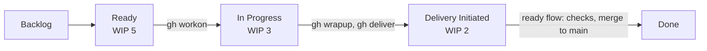

Every change is an issue on the [board](https://github.com/users/DannyShayH/projects/2), flows through Kanban with WIP limits, is built on its own branch with TakT, is checked automatically, and lands on `main` as one commit.

## Pages

- [How we work](/MTGO/way-of-working/how-we-work/): roles, the board, WIP limits, TakT and AI agents. A draft for the team to agree on in issue #9.
- [Docs site brief](/MTGO/way-of-working/docs-site-brief/): the input for the grill session that planned this site and the flow metrics (issue #12).

The planning pages are temporary. They are deleted when real content pages replace them.
