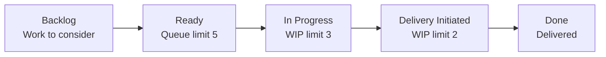

import SectionLinks from "../../../components/section-links.astro"

Every change is an issue on the [board](https://github.com/users/DannyShayH/projects/2), flows through Kanban with WIP limits, is built on its own branch with TakT, is checked automatically, and lands on `main` as one commit.

<figure class="docs-workflow not-content">
<figcaption id="kanban-flow-title">From backlog to delivery</figcaption>

The board flows from left to right. Highlighted columns count as WIP. Scroll horizontally on a narrow screen to read every step.

<ul class="docs-workflow-steps">
  <li><strong>Ready is a queue</strong>Up to five prioritised work items can wait to be pulled. Start work with <code>gh workon</code>. Ready does not count as WIP.</li>
  <li><strong>Work within the limits</strong>In Progress allows three work items; Delivery Initiated allows two. Commit and push during work with <code>gh wrapup</code>.</li>
  <li><strong>Checks complete delivery</strong>The developer runs <code>gh deliver</code>. Successful ready checks merge the change to <code>main</code> and move the issue to Done.</li>
</ul>
</figure>

## Pages

<SectionLinks
  label="Way of working pages"
  links={[
    {
      title: "How we work",
      href: "/MTGO/way-of-working/how-we-work/",
      description:
        "Roles, board policies, TakT and AI agents. A draft for the team to agree in issue #9.",
    },
    {
      title: "Definition of Done",
      href: "/MTGO/way-of-working/definition-of-done/",
      description:
        "Proposed functionality, quality, documentation and delivery criteria for team agreement in issue #9.",
    },
    {
      title: "Coding standard",
      href: "/MTGO/way-of-working/coding-standard/",
      description:
        "How we name, structure, test, document and deliver code. A draft for the team to agree in issue #9.",
    },
    {
      title: "Docs site brief",
      href: "/MTGO/way-of-working/docs-site-brief/",
      description:
        "The planning input for the documentation site and flow metrics in issue #12.",
    },
  ]}
/>

The planning pages are temporary. They are deleted when real content pages replace them.
